# inTandem

**A harness for pairing coding agents: one model plans, another implements, and the planner reviews the result.**

Your planner (Claude Code or Codex) writes a specification. inTandem sends it to an implementer
running on **[OpenCode](https://opencode.ai)** (1.x or 2.x) or **Claude Code** and supervises the
session. If the implementer requests permission, stalls while reasoning, or hangs on a tool call,
inTandem reports that to the planner. You can respond from the dashboard or command line,
including over SSH from a phone. When the implementer finishes, inTandem returns its result and
changed files to the planner for verification and, if appropriate, merging.

inTandem runs as an MCP server alongside those tools; it does not replace them.

<p align="center">
  
</p>

## Why use it

- **Separate planning from implementation.** Use Claude Code or Codex to define and review the
  task, then pick an implementer harness and model per task or per worktree.
- **Choose your implementer harness.** Run OpenCode (1.x or 2.x, across any provider OpenCode
  supports) or Claude Code (on your own Claude subscription, via the Claude Agent SDK).
- **Review the work, not only the summary.** A result must belong to the active specification and
  be written after its latest prompt. The planner inspects the resulting diff and runs checks.
- **Put guardrails around sensitive files.** Configure file globs that implementers may not
  change. inTandem blocks edits before they land (permission rules in OpenCode, a `PreToolUse`
  hook in Claude Code) and checks content hashes to catch changes that bypass tool permissions.
- **Know when a task needs attention.** It reports permission requests, stalled reasoning, and
  unresponsive tools to the planner and the dashboard.
- **Split independent work safely.** Each parallel implementer receives its own Git branch,
  worktree, supervisor, and harness choice, keeping changes separate until review.

## Install

inTandem runs on Linux, macOS and WSL. Native Windows isn't supported yet, so on Windows, install
it inside [WSL](https://learn.microsoft.com/windows/wsl/install).

You need Python 3.12 to 3.14 and [uv](https://docs.astral.sh/uv/).

### With OpenCode (default harness)

inTandem drives OpenCode 1.x or 2.x, whichever you have: it probes the running server to see which
API it speaks. If OpenCode isn't installed when an OpenCode task starts, inTandem installs a
tested 2.x release (`2.3.2`) to `~/.opencode/bin` after verifying the download against the
release's `SHA256SUMS`. Set `INTANDEM_NO_INSTALL=1` to disable auto-install.

```bash
uv tool install intandem        # puts `inTandem` on your PATH
opencode auth login             # connect a model provider (after OpenCode is installed)
```

### With Claude Code as the implementer

To run implementers on Claude Code (using your own `claude` subscription login), install the
optional `claude` extra and sign the `claude` CLI in:

```bash
uv tool install 'intandem[claude]'
claude auth login               # uses your subscription; inTandem never sets ANTHROPIC_API_KEY
```

OpenCode is started lazily only when an OpenCode task runs, so a Claude-only setup does not need
OpenCode installed.

## Connect a planner

Register inTandem as an MCP server:

```bash
claude mcp add inTandem --scope user -- inTandem mcp      # Claude Code
codex mcp add inTandem -- inTandem mcp                    # Codex
```

The server starts when the planner connects and stops when it exits. There is no separate daemon
to start.

## Run your first task

Ask the planner to delegate a task:

> Have an implementation model write the tests for citations.py through inTandem.

The planner writes a specification, submits it, waits for the work to finish, and reviews the
result. Its first response includes a **dashboard link** for monitoring progress and approving
or denying requests.

To set defaults for every task, pass environment variables when you register:

```bash
# OpenCode default
claude mcp add inTandem --scope user \
  -e INTANDEM_MODEL=openrouter/qwen/qwen3-coder \
  -e 'INTANDEM_PROTECTED=["instruction.md"]' \
  -- inTandem mcp

# Claude Code default
claude mcp add inTandem --scope user \
  -e INTANDEM_HARNESS=claude \
  -e INTANDEM_MODEL=claude-sonnet-4-6 \
  -e 'INTANDEM_PROTECTED=["instruction.md"]' \
  -- inTandem mcp
```

You can also pick the harness per implementer with `harness="claude"` or `harness="opencode"` on
`start_implementer`, `spawn_implementer`, or `submit_spec`. For Claude Code, models can be bare
names (`claude-sonnet-4-6`) or `anthropic/<model>`, and `agent` isn't supported. If
`ANTHROPIC_API_KEY` is set in the environment, the `claude` CLI bills that key instead of your
subscription, and inTandem records a `billing_warning` in the journal.

## Use the command line

The command line exposes the same controls and works over SSH:

```bash
inTandem status      # what it's doing right now
inTandem pending     # what it's waiting on
inTandem allow       # or: inTandem deny --message "leave that file alone"
inTandem cost        # what the implementer has spent
```

To run a supervised task directly without MCP:

```bash
inTandem serve ~/work/my-task -m openrouter/qwen/qwen3-coder -p instruction.md
inTandem serve ~/work/my-task --harness claude -m claude-sonnet-4-6 -p instruction.md
```

## How it works

<p align="center">
  
</p>

## Learn more

| | |
| --- | --- |
| [Usage guide](docs/usage.md) | Harnesses, parallel implementers, CLI, exit codes, alerts and configuration |
| [How it works](docs/architecture.md) | Architecture, backend seam, what it enforces and design notes |
| [Backend design notes](docs/design/backends.md) | Neutral backend layer, OpenCode 2, Claude Code and Codex fit |
| [Development](docs/development.md) | Running unit and E2E tests and releasing |
| [Planner skill](skills/intandem-planner/SKILL.md) | The planner loop as an Agent Skill |
