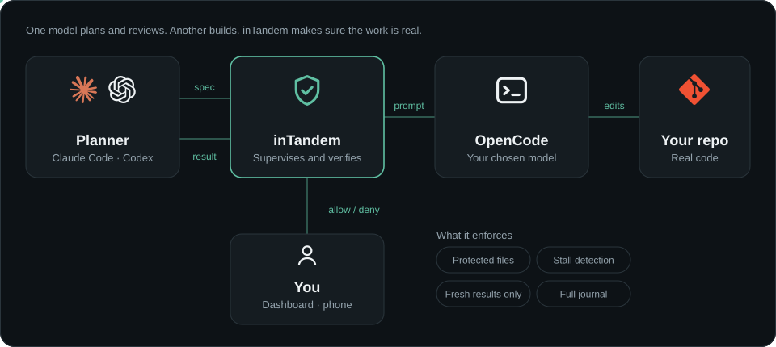
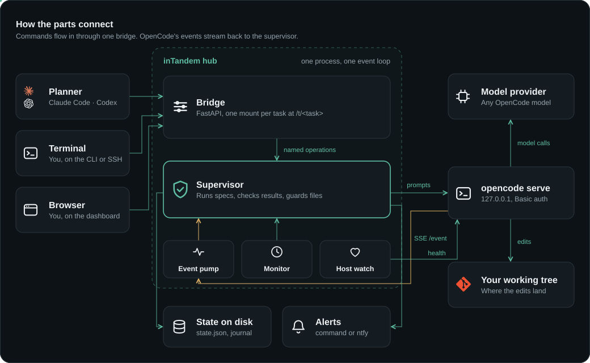

# inTandem

**A harness for pairing coding agents: one model plans, another implements, and the planner reviews the result.**

Your planner (Claude Code or Codex) writes a specification. inTandem sends it to an implementation
model you select in [OpenCode](https://opencode.ai) and supervises the session. If the implementer
requests permission, stalls while reasoning, or hangs on a tool call, inTandem reports that to the
planner. You can respond from the dashboard or command line, including over SSH from a phone.
When the implementer finishes, inTandem returns its result and changed files to the planner for
verification and, if appropriate, merging.

inTandem runs as an MCP server alongside those tools; it does not replace them.

<p align="center">
  
</p>

## Why use it

- **Separate planning from implementation.** Use Claude Code or Codex to define and review the task, then select an implementation model from OpenCode.
- **Review the work, not only the summary.** A result must belong to the active specification and be written after its latest prompt. The planner can inspect the resulting diff.
- **Put guardrails around sensitive files.** Configure file globs that implementers may not change. inTandem blocks edits through permissions and detects changes that bypass them.
- **Know when a task needs attention.** It reports permission requests, stalled reasoning, and unresponsive tools to the planner and the dashboard.
- **Split independent work safely.** Each parallel implementer receives its own Git branch and worktree, keeping its changes separate until review.

## Install

You need Python 3.12+, [uv](https://docs.astral.sh/uv/) and OpenCode 1.x.

```bash
npm i -g opencode-ai@1          # OpenCode 2 isn't supported yet
opencode auth login             # connect a model provider
uv tool install intandem        # puts `inTandem` on your PATH
```

## Connect a planner

Register inTandem as an MCP server:

```bash
claude mcp add inTandem --scope user -- inTandem mcp      # Claude Code
codex mcp add inTandem -- inTandem mcp                    # Codex
```

The server starts when the planner connects and stops when it exits. There is no separate daemon
to start.

## Run your first task

Ask the planner to delegate a task:

> Have an implementation model write the tests for citations.py through inTandem.

The planner writes a specification, submits it, waits for the work to finish, and reviews the
result. Its first response includes a **dashboard link** for monitoring progress and approving
or denying requests.

To set a default model or protect files for every task, add them when you register:

```bash
claude mcp add inTandem --scope user \
  -e INTANDEM_MODEL=openrouter/qwen/qwen3-coder \
  -e 'INTANDEM_PROTECTED=["instruction.md"]' \
  -- inTandem mcp
```

## Use the command line

The command line exposes the same controls and can be used over SSH:

```bash
inTandem status      # what it's doing right now
inTandem pending     # what it's waiting on
inTandem allow       # or: inTandem deny --message "leave that file alone"
inTandem cost        # what the implementer has spent
```

## How it works

<p align="center">
  
</p>

## Learn more

| | |
| --- | --- |
| [Usage guide](https://github.com/mumoj/inTandem/blob/main/docs/usage.md) | Parallel implementers, the CLI, exit codes, alerts and configuration |
| [How it works](https://github.com/mumoj/inTandem/blob/main/docs/architecture.md) | Architecture, what it enforces and design notes |
| [Development](https://github.com/mumoj/inTandem/blob/main/docs/development.md) | Running the tests and releasing |
| [Planner skill](https://github.com/mumoj/inTandem/blob/main/skills/intandem-planner/SKILL.md) | The planner loop as an Agent Skill |
