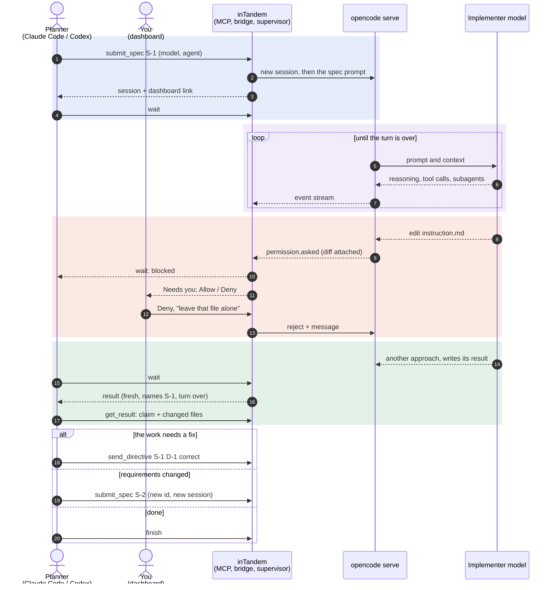

# How inTandem works

<p align="center">
  
</p>

The planner and a human drive the same bridge, so anything the planner can do, you can do
from the dashboard or a phone, and every call from any of them lands in one journal.

## A typical run

One spec end to end: the implementer tries to edit a protected file, you deny it from the
dashboard, it finishes, and the planner checks the work before moving on.



## One process, one OpenCode

Every task runs on a hub, so nothing sprawls. Under the MCP server, `inTandem mcp` is the only
inTandem process, and `inTandem serve` runs the same hub for a task started by hand:

- **One FastAPI app, one uvicorn.** Each implementer's bridge is mounted at `/t/<task>` in a
  single app, beside an overview page at `/ui` that lists every implementer. A task's manifest
  points at its mount, so the CLI and the tools find every task the same way.
- **One OpenCode server.** Every implementer is a tenant of it, scoped to its own directory
  through OpenCode's `directory` parameter and reading its own events from the server-wide
  stream. It starts when the planner connects, so its startup is paid once per session.
- **Subagents stay guarded.** A server-wide config cannot know each implementer's protected
  files, so when a subagent's session appears, its supervisor patches that session to deny
  edits to them. An edit made before the patch lands is caught by the content hash, which
  stops the spec.
- **Nothing outlives the session.** On Linux the kernel stops OpenCode if the hub's process
  dies without cleaning up, even on `kill -9`; elsewhere, the next hub stops any server its
  predecessor left.
- **One server, one point of failure.** A wedged OpenCode stalls every implementer on it. The
  hub replaces a server that dies, and each task resumes from its state file.

## What it enforces

**A Spec ID is immutable and gets its own session.** Resubmitting the same id and text is a
no-op, so a retrying planner cannot duplicate work. The same id with different text is refused.

**A directive belongs to one spec.** A directive names its spec and is refused once that spec
is no longer active. In the file-based version of this harness, a leftover correction outlived
its spec and ended a later turn before the implementer had read its new instructions.

**Protected files are enforced twice.** A permission rule stops an edit and waits for a human
with the diff attached. A content hash, checked while the spec runs, catches the edits that
arrive another way, such as a shell redirect. Either one aborts the session. The rule is set
on the spec's session, and patched onto each subagent's session as it appears, because a
subagent's session does not inherit the spec's rules. A subagent edit that beats the patch is
left to the hash.

**A restart keeps protection honest.** Each spec's baseline records the globs it was taken
under. Restarting with a different protect list checks the old files against the old baseline
first: intact, the spec moves to the new list; changed, the old list stays in force until the
files are restored.

**A result has to be fresh.** The implementer writes JSON to a path given in its prompt. It
counts only if it names the active spec and was written after the latest prompt.

**Delivery is idempotent.** Every prompt carries a marker. After a restart, inTandem adopts the
session it recorded and checks for the marker before sending anything again.

## On disk

Everything about one task lives in one directory under the state root:

```
journal.jsonl        one line per state change: grep this first
state.json           resumable supervisor state
events.sse           the raw OpenCode event stream, oversized lines stubbed
notifications.log    every alert
manifest.json        bridge URL and token, OpenCode login, 0600, removed on clean exit
results/<spec>.json  the implementer's results
sessions/<spec>/     final messages and totals per spec
```

Beside the tasks, `hosts/` holds the shared OpenCode server's log and a record of it, which is
how a later session finds a server orphaned by a crash. `worktrees/` holds parallel
implementers' worktrees, and `landed/` the state of implementers that were merged or discarded.

Files holding tokens, prompts or model output are created 0600.

## Design notes

- **One process, one event loop, one task group per task.** A task's event pump, monitor and
  host watch run under one `asyncio.TaskGroup`; if one dies the rest stop with it, and an exit
  stack frees its OpenCode instance on the way out. One task failing leaves the others running.
- **OpenCode runs as a separate process.** OpenCode's SDK can host it in-process, but a
  supervisor that shares a process with what it supervises cannot restart it when it wedges.
  One OpenCode is shared by every task on a hub, and replaced if it dies.
- **A task is not a server.** `open_task` builds a supervisor and its bridge app with no server
  of its own, and the hub mounts it beside the others, whether `inTandem mcp` or `inTandem serve`
  runs that hub.
- **FastAPI only where there is a server.** The OpenCode client is httpx, the supervisor is
  plain asyncio, and the CLI is Typer over the same pydantic models the bridge serves.
- **`OpenCodeAPI` is a protocol.** The supervisor never sees HTTP, so the unit tests use an
  in-memory fake and an OpenCode 2 adapter would be one new class.
- **Plain files, not a database.** The planner reads the journal with `grep`.
- **Git is the registry.** Parallel implementers are found from `git worktree list`, so there
  is no second record of them that could disagree with the repository.
- **The MCP tools are a thin client.** They keep no state of their own: they find a
  supervisor by directory, start one on the session's hub if there is none, and call the same
  bridge endpoints as the CLI. Restarting the planner stops its implementers but loses nothing:
  each resumes from its state file on next use.
- **The CLI came first.** Any agent can run a shell command, so inTandem began as a CLI a
  planner shelled out to, with exit codes as its interface. Structured tools suited planners
  better, so MCP took over that role; the CLI stayed because a human in a terminal, and a
  script in CI, still need a way in.
- **The dashboard is one static page.** It holds no data and needs no build step. It reads its
  token from the URL fragment and polls the same authenticated endpoints as everyone else.
