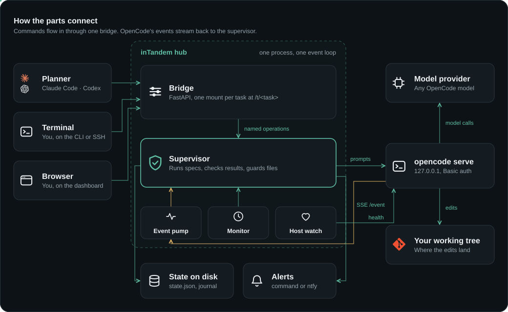
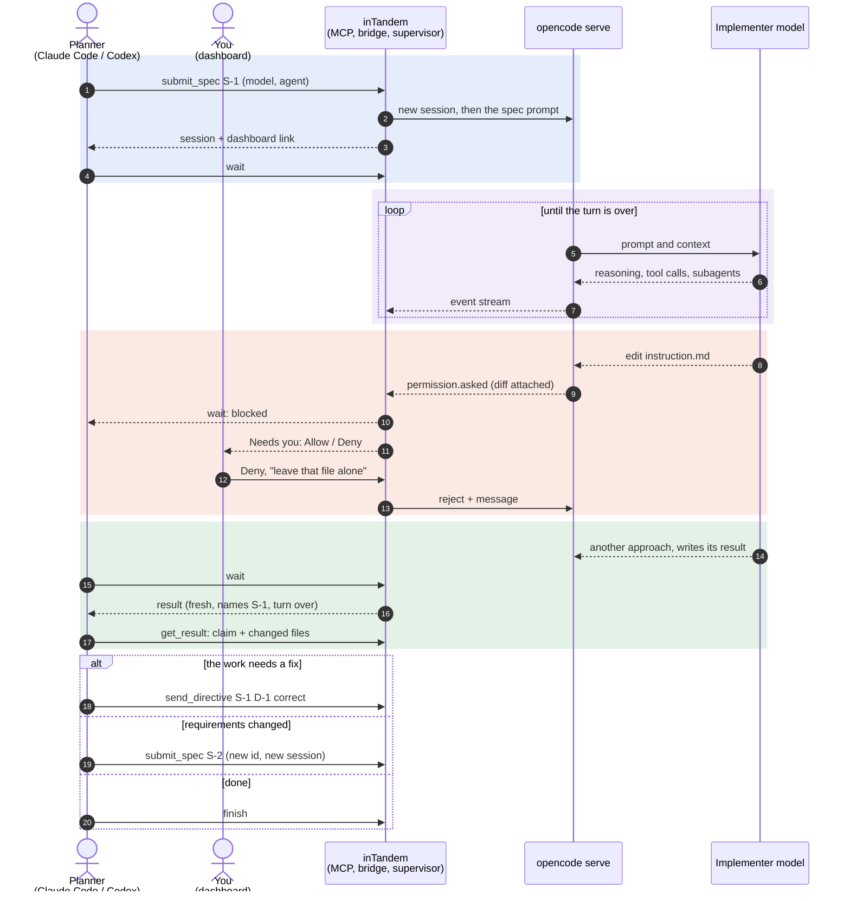

# How inTandem works

<p align="center">
  
</p>

The planner, dashboard, and CLI use the same bridge. A person can inspect or respond to the
same task the planner is managing, and every request is recorded in one journal.

## A typical run

This example follows one specification from submission to review. The implementer attempts a
protected edit, a person rejects it from the dashboard, and the planner reviews the completed
work before deciding what to do next.



## One process, one OpenCode

Each planner session has one inTandem hub. `inTandem mcp` runs that hub for an MCP session, and
`inTandem serve` runs the same hub for a task started directly.

- **One FastAPI application.** Each implementer's bridge is mounted at `/t/<task>` in one
  application. An overview page at `/ui` lists all implementers. Task manifests point to their
  mount, so the CLI and MCP tools locate tasks in the same way.
- **One OpenCode server per hub.** Implementers share the server while remaining scoped to
  separate directories through OpenCode's `directory` parameter. Each supervisor reads its own
  events from the server-wide stream. Starting OpenCode once per session avoids repeating its
  startup work for every task.
- **Protected-file rules extend to subagents.** The server-wide configuration cannot express
  each implementer's protected files. When a subagent session appears, its supervisor adds the
  rule to that session. A content hash detects an edit that arrives before the rule is applied
  and stops the specification.
- **Session cleanup is tied to the hub.** On Linux, the kernel stops OpenCode if the hub process
  dies without cleanup, including after `kill -9`. On other platforms, the next hub stops a
  server left by its predecessor.
- **Shared-server failure is handled explicitly.** If OpenCode wedges, every implementer on that
  hub stalls. The hub replaces a server that dies, and each task resumes from its state file.

## What it enforces

These rules keep the planner's view of a task aligned with the work OpenCode performs.

**Specification IDs are immutable and use separate sessions.** Resubmitting the same ID and
text does nothing, so a retried planner request cannot duplicate work. Reusing an ID with
different text is rejected.

**Directives apply to one specification.** A directive names its specification and is rejected
when that specification is no longer active. This prevents a correction intended for earlier
work from affecting a later task.

**Protected files have two safeguards.** A permission rule stops an edit and presents the diff
for review. A content hash is checked while the specification runs and catches edits that
arrive another way, such as a shell redirect. Either condition stops the session. The rule is
set on the specification's session and added to each subagent session as it appears, since
subagents do not inherit it. The hash covers an edit that happens before that addition.

**Restarts preserve protected-file checks.** Each specification baseline records the globs in
effect when it was created. If a restart uses a different list, inTandem first checks the old
files against the old baseline. If they are unchanged, the new list takes effect; otherwise,
the old list remains in force until the files are restored.

**Results must match the active work.** The implementer writes JSON to a path supplied in its
prompt. inTandem accepts it only when it names the active specification and was written after
the latest prompt.

**Prompts are delivered idempotently.** Each prompt has a marker. After a restart, inTandem
adopts its recorded session and checks for that marker before sending the prompt again.

## On disk

Each task stores its state in one directory under the state root:

```
journal.jsonl        one line per state change: grep this first
state.json           resumable supervisor state
events.sse           the raw OpenCode event stream, oversized lines stubbed
notifications.log    every alert
manifest.json        bridge URL and token, OpenCode login, 0600, removed on clean exit
results/<spec>.json  the implementer's results
sessions/<spec>/     final messages and totals per spec
```

Alongside task directories, `hosts/` stores the shared OpenCode server log and record. A later
session uses that record to find a server orphaned by a crash. `worktrees/` contains parallel
implementer worktrees, and `landed/` retains the state of implementers that were merged or
discarded.

Files containing tokens, prompts, or model output are created with mode `0600`.

## Design notes

- **One process, one event loop, one task group per task.** A task's event pump, monitor, and
  host watch run in one `asyncio.TaskGroup`. If one fails, the group stops together and an exit
  stack releases its OpenCode instance. Other tasks continue running.
- **OpenCode is a separate process.** Its SDK can run it in-process, but a supervisor cannot
  reliably restart a component sharing its process. A hub shares one OpenCode process across
  tasks and replaces it if it dies.
- **A task is not a server.** `open_task` builds a supervisor and bridge application without
  starting a server. The hub mounts it beside other tasks whether it is run by `inTandem mcp` or
  `inTandem serve`.
- **FastAPI is limited to the serving boundary.** The OpenCode client uses httpx, the
  supervisor uses asyncio, and the CLI uses Typer with the same Pydantic models served by the
  bridge.
- **`OpenCodeAPI` is a protocol.** The supervisor does not depend on HTTP directly, which lets
  unit tests use an in-memory fake and keeps an OpenCode 2 adapter confined to one class.
- **Task state uses plain files.** The journal is directly inspectable with tools such as
  `grep`; no database is required for normal inspection.
- **Git records parallel worktrees.** inTandem reads `git worktree list` rather than keeping a
  separate registry that could disagree with the repository.
- **MCP tools are stateless clients.** They find a supervisor by directory, start one on the
  session hub when needed, and call the same bridge endpoints as the CLI. Restarting the planner
  stops its implementers without losing state; the next use resumes from the state file.
- **The CLI remains available outside MCP.** It began as the first planner interface and still
  gives terminal users, CI scripts, and shell-based agents access to the same operations.
- **The dashboard is a static page.** It stores no task data and needs no build step. It reads
  its token from the URL fragment and polls the same authenticated endpoints as the other
  clients.
