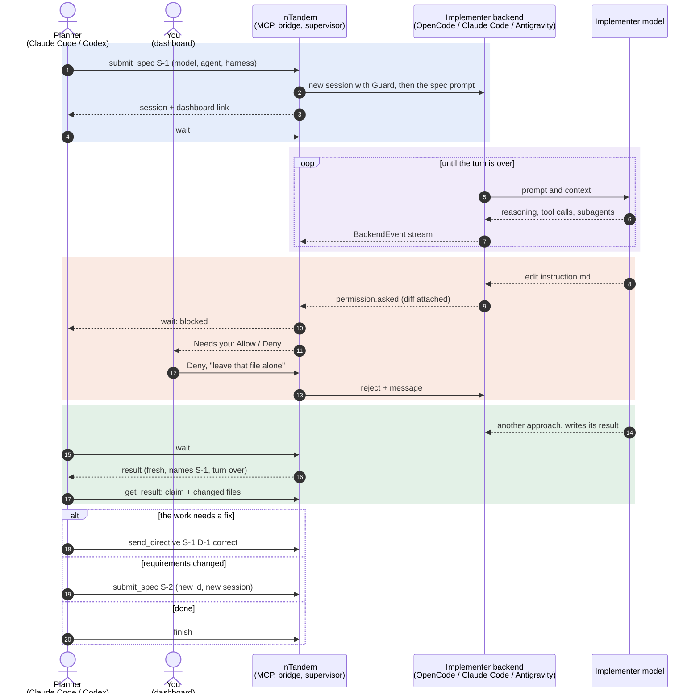

# How inTandem works

<p align="center">
  
</p>

The planner, dashboard, and CLI use the same bridge. A person can inspect or respond to the
same task the planner is managing, and every request is recorded in one journal.

## A typical run

This example follows one specification from submission to review. The implementer attempts a
protected edit, a person rejects it from the dashboard, and the planner reviews the completed
work before deciding what to do next.



## One hub, multiple implementer harnesses

Each planner session has one inTandem hub. `inTandem mcp` runs that hub for an MCP session, and
`inTandem serve` runs the same hub for a task started directly.

- **One FastAPI application.** Each implementer's bridge is mounted at `/t/<task>` in one
  application. An overview page at `/ui` lists all implementers. Task manifests point to their
  mount, so the CLI and MCP tools locate tasks in the same way.
- **Neutral backend layer (`intandem/backend/`).** The supervisor, activity tracker, notifier,
  and bridge depend only on `ImplementerBackend`, neutral models (`Session`, `Message`,
  `PermissionRequest`, `QuestionRequest`, `ModelRef`, `Guard`), and typed `BackendEvent`s.
  Harness-specific wire shapes stay inside each adapter package:
  - `intandem/opencode/` — OpenCode 1.x HTTP/SSE adapter, shared host lifecycle, and checksum-verified installer.
  - `intandem/opencode2/` — OpenCode 2.x HTTP/SSE adapter (stateful tool-call translator, forms-to-questions mapping, `{action, resource, effect}` rules).
  - `intandem/claude/` — Claude Code adapter over the optional `claude-agent-sdk` (`PreToolUse` hook guard, push-to-pull pending futures, per-session CLI process).
  - `intandem/antigravity/` — Antigravity CLI adapter: a stdlib JSON-RPC 2.0 ACP client over `agy acp`'s stdio (`session/request_permission` guard, one agent process per task).
- **Lazy shared OpenCode server.** OpenCode tasks share one `opencode serve` process per hub,
  scoped to separate directories (`directory` on 1.x, `location[directory]` on 2.x). The host
  starts lazily on the first OpenCode task and probes `/global/health` then `/api/info` to select
  the 1.x or 2.x client. Claude Code and Antigravity sessions never start or download OpenCode.
- **Per-session Claude Code CLI.** Each Claude Code session spawns the user's own `claude` CLI
  inside the task directory via the Agent SDK, using `claude auth login` rather than an API key.
  Starting a new spec disconnects the previous session's CLI while keeping its transcript and
  totals readable.
- **One `agy acp` per Antigravity task.** The backend starts the user's signed-in `agy` as an ACP
  agent in the task directory and opens one ACP session per spec, closing the previous one.
- **Cleanup is tied to the hub.** On Linux, `PR_SET_PDEATHSIG` stops a shared OpenCode host if
  the hub dies without cleanup, including after `kill -9`. On other platforms, the next hub reaps
  any orphaned host recorded under `hosts/`. Closing the hub disconnects every active backend.

## What it enforces

These rules keep the planner's view of a task aligned with the work the implementer performs,
regardless of harness.

**Specification IDs are immutable and use separate sessions.** Resubmitting the same ID and
text does nothing, so a retried planner request cannot duplicate work. Reusing an ID with
different text, model, or agent is rejected.

**Directives apply to one specification.** A directive names its specification and is rejected
when that specification is no longer active. This prevents a correction intended for earlier
work from affecting a later task.

**Protected files have two safeguards.**
1. *Pre-edit backend guard.* OpenCode enforces protected globs via an ordered ruleset (last match
   wins: broad allows first, then `ask` per protected pattern; subagent sessions receive `deny`
   appended to their own rules). Claude Code enforces them via a fail-closed `PreToolUse` hook
   (`on_failure="block"`) backed by `can_use_tool`, covering both main and subagent tool calls. Antigravity parks every protected edit's
   `session/request_permission`, even unattended, and never picks agy's `allow_always`.
2. *Continuous content-hash check.* The supervisor snapshots SHA-256 hashes of protected patterns
   and checks them on every tick and on `file.edited` / turn-end events. Edits that bypass tool
   permissions (such as a shell redirect) abort the turn and block further specs or directives
   until the files are restored.

**Restarts preserve protected-file checks.** Each specification baseline records the globs in
effect when it was created. If a restart uses a different list, inTandem first checks the old
files against the old baseline. If they are unchanged, the new list takes effect; otherwise,
the old list remains in force until the files are restored.

**Results must match the active work.** The implementer writes JSON to a path supplied in its
prompt. inTandem accepts it only when it names the active specification, was written after the
latest prompt, and the turn has ended.

**Prompts are delivered idempotently.** Each prompt carries a marker line. After a restart,
inTandem adopts its recorded session (when the backend still has it) and checks for that marker
before sending the prompt again.

## On disk

Each task stores its state in one directory under the state root:

```
journal.jsonl        one line per state change: grep this first
state.json           resumable supervisor state
events.sse           the raw backend event stream, oversized lines stubbed
notifications.log    every alert
manifest.json        bridge URL and token (and OpenCode login when applicable), 0600, removed on clean exit
results/<spec>.json  the implementer's results
sessions/<spec>/     final messages and totals per spec
```

Alongside task directories, `hosts/` stores the shared OpenCode server log and record. `worktrees/`
contains parallel implementer worktrees, and `landed/` retains the state of implementers that were
merged or discarded.

Files containing tokens, prompts, or model output are created with mode `0600`.

## Design notes

- **One process, one event loop, one task group per task.** A task's event pump, monitor, and
  host watch run in one `asyncio.TaskGroup`. If one fails, the group stops together and an exit
  stack closes its backend. Other tasks on the hub continue running.
- **Pull-shaped protocol over push and pull harnesses.** `ImplementerBackend` exposes pull methods
  (`permissions()`, `questions()`, `events()`). HTTP backends query their server; push backends
  (Claude Agent SDK, Antigravity's ACP, and Codex in the future) park pending futures in a map and enqueue events,
  keeping the supervisor free of callback re-entrancy.
- **Shared utilities live in `intandem/backend/`.** `jsonpath.py` (typed dict traversal),
  `stream.py` (`StreamRecorder`), and `diff.py` (worktree `git diff`) are shared across adapters
  rather than tied to OpenCode.
- **A task is not a server.** `open_task` builds a supervisor and bridge application without
  starting a server. The hub mounts it beside other tasks whether it is run by `inTandem mcp` or
  `inTandem serve`.
- **FastAPI is limited to the serving boundary.** Adapters use `httpx` or the Agent SDK, the
  supervisor uses `asyncio`, and the CLI uses Typer with the same Pydantic models served by the
  bridge.
- **Task state uses plain files.** The journal is directly inspectable with tools such as `grep`;
  no database is required for normal inspection.
- **Git records parallel worktrees.** inTandem reads `git worktree list` rather than keeping a
  separate registry that could disagree with the repository.
- **MCP tools are stateless clients.** They find a supervisor by directory, start one on the
  session hub when needed, and call the same bridge endpoints as the CLI.
- **The dashboard is a static page.** It stores no task data and needs no build step. It reads
  its token from the URL fragment and polls the same authenticated endpoints as the other clients.
